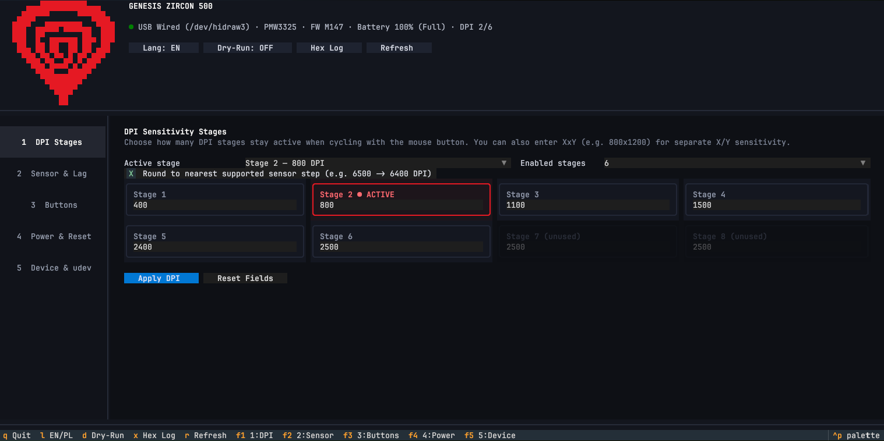
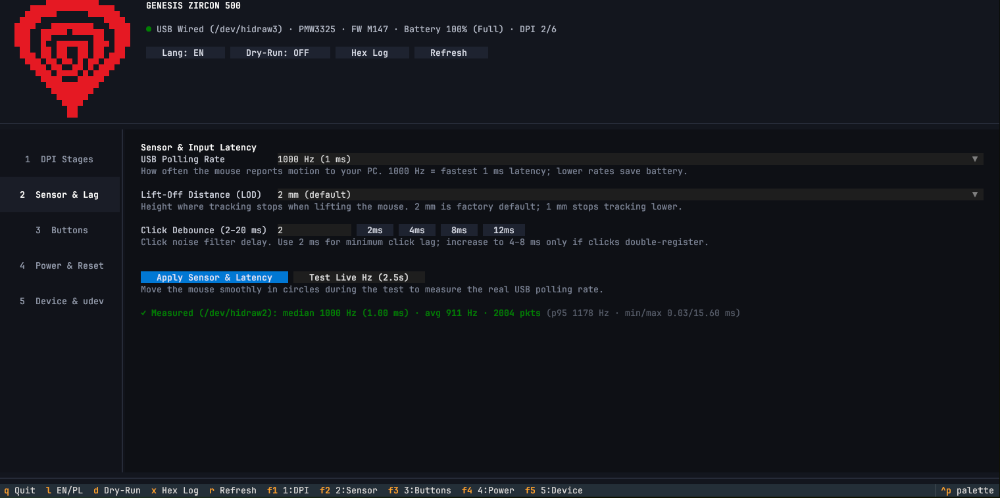
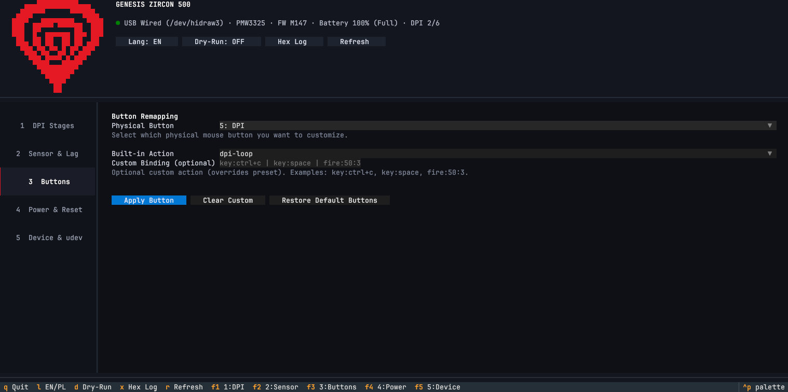
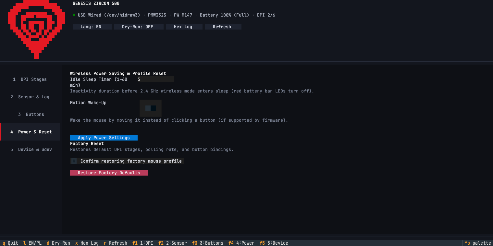
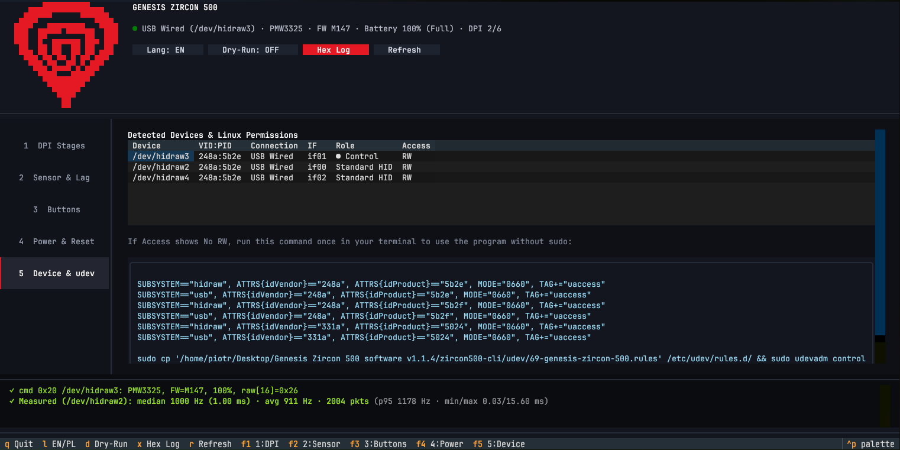

# Genesis Zircon 500  Linux CLI & TUI

Nieoficjalne narzędzie do pełnej konfiguracji myszy **Genesis Zircon 500 (v1)** pod systemem Linux (po kablu USB oraz przez odbiornik 2.4 GHz), bez potrzeby instalowania Windowsa ani używania Wine.

[🇵🇱 Wersja polska](#polski) · [🇬🇧 English version](#english)

---

<a id="polski"></a>
## 🇵🇱 Polski

### Dlaczego powstał ten projekt

Oficjalne oprogramowanie Genesis do Zircona 500 działa wyłącznie na Windowsie. To narzędzie pozwala zmienić wszystkie najważniejsze ustawienia myszy bezpośrednio z terminala na Linuxie  zarówno w interaktywnym menu obsługiwanym klawiaturą i myszą, jak i zwykłymi poleceniami w skrypcie lub terminalu.

### Obsługiwane urządzenia

- **USB (przewodowo):** `248a:5b2e` (oraz `331a:5024`)
- **2.4 GHz (odbiornik bezprzewodowy):** `248a:5b2f`
- **Sensor:** PMW3325 (`0x3325`, 59 sprzętowych kroków od 200 do 10 000 DPI)

---

### Zrzuty ekranu

| Progi DPI | Sensor i opóźnienia |
| :---: | :---: |
|  |  |

| Mapowanie przycisków | Zasilanie i reset | Uprawnienia udev |
| :---: | :---: | :---: |
|  |  |  |

---

### Funkcje

- **Interaktywne menu (`zircon500`)**  pełne menu w terminalu z obsługą klawiatury (`1..5`, `F1..F5`, `Tab`) i myszy, przełącznikiem języka `PL/EN` (`L`) oraz trybem podglądu bez zapisu na mysz (`--dry-run` / `D`).
- **Progi DPI (1–8 progów)**  ustawianie dowolnej liczby aktywnych progów pod przyciskiem DPI, osobna czułość osi X/Y (np. `800x1200`), opcjonalne zaokrąglanie do natywnych kroków sensora PMW3325, podgląd aktywnego progu na żywo oraz zapamiętywanie wpisanych progów lokalnie w `~/.config/zircon500/profile.json`.
- **Sensor i opóźnienia (Input Lag)**  zmiana taktowania USB (`125 / 250 / 500 / 1000 Hz`), wysokości odcięcia sensora LOD (`1 mm` lub `2 mm`), czasu debounce kliku (`2–20 ms`) oraz wbudowany pomiar rzeczywistego polling rate (`poll-test`) podczas poruszania myszą.
- **Mapowanie przycisków**  przypisywanie gotowych funkcji (np. `dpi-loop`, `vol-up`, `triple-click`, `disable`), skrótów klawiszowych (np. `key:ctrl+c`, `key:space`), multi-kliku (`fire:50:3`) oraz szybkie przywracanie domyślnych wszystkich 6 przycisków jednym kliknięciem.
- **Zasilanie 2.4 GHz i reset**  ustawienie czasu przejścia w stan uśpienia (`1–60 min`), opcja Motion Wake-Up (dla wspieranych wersji firmware) oraz bezpieczny reset profilu do ustawień fabrycznych.
- **Brak dotykania firmware**  narzędzie nigdy nie wysyła komend aktualizacji firmware ani bootloadera.

---

### Instalacja

Wymagany Python `>= 3.11`. Zalecana instalacja przez `uv` lub `pipx`:

```bash
git clone https://github.com/cukierbezsoli/zircon500-linux-cli.git
cd zircon500-linux-cli
uv tool install .
```

Lub z użyciem `pipx`:

```bash
pipx install .
```

### Uprawnienia w Linuxie (bez `sudo`)

Żeby aplikacja miała dostęp do myszy bez uprawnień roota, skopiuj regułę `udev` i przeładuj reguły systemowe:

```bash
sudo cp udev/69-genesis-zircon-500.rules /etc/udev/rules.d/
sudo udevadm control --reload-rules && sudo udevadm trigger --subsystem-match=hidraw --action=add
```

W razie potrzeby regułę można też wydrukować z poziomu programu: `zircon500 udev-rules`.

---

### Użycie

Uruchomienie interaktywnego menu:

```bash
zircon500
```

Przykładowe polecenia w trybie tekstowym:

```bash
zircon500 info                           # status myszy, bateria, firmware, wykryte interfejsy
zircon500 dpi 400 800 1600 --active 1    # ustawienie 3 progów DPI i aktywacja drugiego (800 DPI)
zircon500 dpi --list-steps               # lista wszystkich 59 kroków PMW3325
zircon500 rate 1000                      # polling rate 1000 Hz (1 ms)
zircon500 lod 1                          # Lift-Off Distance 1 mm
zircon500 debounce 2                     # najniższy debounce kliku (2 ms)
zircon500 button forward key:ctrl+c      # przypisanie Ctrl+C pod boczny przycisk
zircon500 poll-test --seconds 3          # pomiar rzeczywistych Hz podczas ruchu myszą
zircon500 reset-defaults                 # przywrócenie profilu fabrycznego
```

Każdą komendę zapisującą można bezpiecznie podejrzeć z flagą `--dry-run`.

### Środowisko testowe i błędy

Program był budowany i testowany na żywo na:
- **System:** CachyOS Linux (Arch-based), kernel `7.3.4-1-cachyos`, Python `3.14`
- **Mysz:** Genesis Zircon 500 (v1), `248a:5b2e` (USB), sensor `PMW3325`, firmware `M147`

Jeśli trafisz na błąd na innej dystrybucji Linuxa, z innym firmware albo w trybie 2.4 GHz, zgłoś go w zakładce [Issues](https://github.com/cukierbezsoli/zircon500-linux-cli/issues) (najlepiej z wynikiem `zircon500 info`).

---

<a id="english"></a>
## 🇬🇧 English

### About

An unofficial Linux configurator for the **Genesis Zircon 500 (v1)** gaming mouse, supporting both USB wired and 2.4 GHz wireless dongle modes without needing Windows, Wine, or a VM.

### Supported Hardware

- **Wired USB:** `248a:5b2e` (and `331a:5024`)
- **2.4 GHz Wireless Receiver:** `248a:5b2f`
- **Sensor:** PMW3325 (`0x3325`, 59 hardware steps from 200 to 10,000 DPI)

---

### Screenshots

| DPI Stages | Sensor & Latency |
| :---: | :---: |
|  |  |

| Button Remapping | Power & Reset | Device & udev |
| :---: | :---: | :---: |
|  |  |  |

---

### Features

- **Interactive TUI (`zircon500`)**  clean terminal interface navigable via keyboard (`1..5`, `F1..F5`, `Tab`) and mouse, with instant `EN/PL` switching (`L`) and `--dry-run` simulation mode (`D`).
- **DPI Stages (1–8 stages)**  configure how many DPI stages stay active under the mouse DPI button, optional split X/Y sensitivity (e.g. `800x1200`), optional snapping to PMW3325 hardware steps, live active-stage tracking, and automatic local persistence in `~/.config/zircon500/profile.json`.
- **Sensor & Latency**  configure USB polling rate (`125 / 250 / 500 / 1000 Hz`), Lift-Off Distance (`1 mm` or `2 mm`), click debounce delay (`2–20 ms`), and test real USB packet cadence live via `poll-test`.
- **Button Remapping**  bind built-in presets (`dpi-loop`, `vol-up`, `triple-click`, `disable`, etc.), keyboard combos (`key:ctrl+c`, `key:space`), multi-click (`fire:50:3`), or restore default bindings for all 6 buttons with one action.
- **2.4 GHz Power & Profile Reset**  set idle sleep timeout (`1–60 min`), Motion Wake-Up (on supported firmware), and safe factory profile reset.
- **Bootloader-safe**  firmware flashing / DFU commands are completely excluded.

---

### Installation

Requires Python `>= 3.11`:

```bash
git clone https://github.com/cukierbezsoli/zircon500-linux-cli.git
cd zircon500-linux-cli
uv tool install .
```

Or with `pipx`:

```bash
pipx install .
```

### Linux Permissions (non-root)

Install the included `udev` rule so the tool can access the mouse without `sudo`:

```bash
sudo cp udev/69-genesis-zircon-500.rules /etc/udev/rules.d/
sudo udevadm control --reload-rules && sudo udevadm trigger --subsystem-match=hidraw --action=add
```

You can also view the rule anytime with `zircon500 udev-rules`.

---

### Usage

Launch the interactive TUI:

```bash
zircon500
```

Direct CLI commands:

```bash
zircon500 info                           # mouse status, battery, firmware, HID interfaces
zircon500 dpi 400 800 1600 --active 1    # set 3 DPI stages and activate stage #2 (800 DPI)
zircon500 dpi --list-steps               # show all 59 PMW3325 hardware steps
zircon500 rate 1000                      # set 1000 Hz polling rate (1 ms)
zircon500 lod 1                          # set 1 mm Lift-Off Distance
zircon500 debounce 2                     # set minimum click debounce (2 ms)
zircon500 button forward key:ctrl+c      # bind Ctrl+C to the side forward button
zircon500 poll-test --seconds 3          # measure real USB polling rate while moving mouse
zircon500 reset-defaults                 # restore factory mouse profile
```

Pass `--dry-run` to preview generated HID packets without writing to the device.

### Test Environment & Issues

Built and tested on live hardware with:
- **OS:** CachyOS Linux (Arch-based), kernel `7.3.4-1-cachyos`, Python `3.14`
- **Mouse:** Genesis Zircon 500 (v1), `248a:5b2e` (USB), `PMW3325` sensor, firmware `M147`

If you run into any bugs on another Linux distribution, different firmware, or in 2.4 GHz wireless mode, please open a report in [Issues](https://github.com/cukierbezsoli/zircon500-linux-cli/issues) (ideally including the output of `zircon500 info`).
